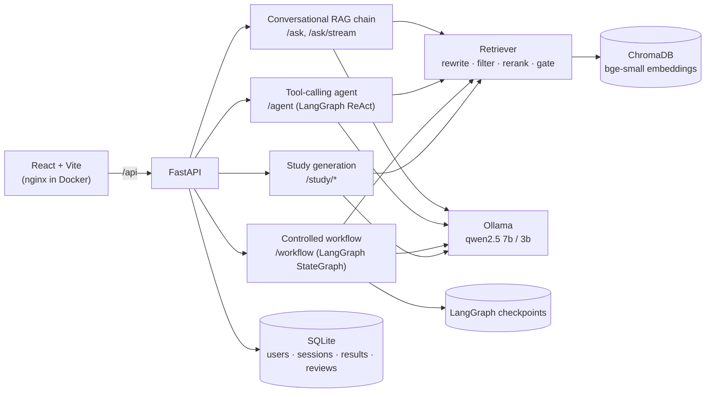

# AI Knowledge Assistant

An internal knowledge and study assistant for a vocational training programme. Staff upload course
handouts and policy documents; students ask questions and get answers grounded in those documents, with
the page each answer came from — and a plain statement when an answer comes from general knowledge
instead. Built on **LangChain, LangGraph, ChromaDB, FastAPI and React**, with local models served by
**Ollama**, so no question or document leaves the machine.

## What it does

**For students**
- **Ask** — conversational question answering over the course materials, streamed token by token, with
  citations, follow-up understanding ("what about the second one?"), and an optional subject filter.
- **My course, Guide, Quiz, Flashcards** — study guides, server-graded quizzes and flashcards generated
  from any document, each item citing its page.
- **Placement** — mock job-interview questions about the course, scored point by point with feedback.
- **Progress** — real counts of questions asked and practice done.

**For staff**
- **Documents** — add files (PDF, Word, Markdown, text, CSV) or web pages; remove them.
- **Monitoring** — live latency and satisfaction, the latest evaluation results, the controlled
  workflow's graph, and a **human review queue** for answers the workflow could not verify.

**Behind it**
- A **tool-calling agent** (`/agent`) with knowledge search, calculator, document listing and
  summarising, web search and study-history lookup.
- A **LangGraph controlled workflow** (`/workflow`): classify → search → generate → validate → retry →
  human approval → respond. Prompt-injection attempts are refused before any model sees them.

## Architecture



## Quick start

### Docker (recommended)

```bash
cp .env.example .env        # set SESSION_SECRET, Google OAuth keys and ADMIN_EMAILS
docker compose up --build
```

Open **http://localhost:8080**. The first start downloads the two Ollama models (about 6.6 GB) into a
volume; later starts take seconds.

**Speed:** Ollama in a container runs on the CPU unless you enable the GPU block in
`docker-compose.yml`. Measured on the development laptop, a streamed answer took about 90 seconds in
Docker against a few seconds with Ollama running natively. If Ollama is already installed on the host,
point the backend at it instead: set `OLLAMA_BASE_URL=http://host.docker.internal:11434` under
`backend.environment` and remove the two `ollama` services. All data — vectors, accounts, uploads, workflow checkpoints — lives in
the `data` volume. Set `PUBLIC_URL` when serving from anywhere other than `http://localhost:8080`, and
register `${PUBLIC_URL}/api/auth/google/callback` as the Google OAuth redirect URI.

### Local development

Prerequisites: Python 3.14, Node 22 or newer, and [Ollama](https://ollama.com) with `qwen2.5:7b` and
`qwen2.5:3b` pulled.

```bash
pip install -r requirements.txt
cp .env.example .env                      # then edit
ollama serve
uvicorn app:app --host 127.0.0.1 --port 8000
cd frontend && npm install && npm run dev
```

Open **http://127.0.0.1:5173** — `127.0.0.1`, not `localhost`: the session cookie belongs to the
backend's host, and a browser treats the two as different sites.

## Configuration

Every setting is an environment variable with a working default; `.env.example` documents them all.
The ones you will touch:

| Variable | Purpose |
|---|---|
| `ADMIN_EMAILS` | Verified Google accounts allowed to add/remove documents and see Monitoring |
| `GOOGLE_CLIENT_ID`, `GOOGLE_CLIENT_SECRET`, `OAUTH_REDIRECT_URI` | Google sign-in |
| `SESSION_SECRET`, `COOKIE_SECURE` | Session cookie signing; `COOKIE_SECURE=true` behind HTTPS |
| `OLLAMA_MODEL`, `OLLAMA_MODEL_FAST`, `OLLAMA_BASE_URL` | Models and where Ollama runs |
| `RETRIEVAL_STRATEGY` | `similarity` (default) · `mmr` · `multi_query` · `compression` · `parent` |
| `LANGSMITH_TRACING`, `LANGSMITH_API_KEY`, `LANGSMITH_PROJECT` | Optional LangSmith tracing |

## Tests and evaluation

| Command | What it checks | Needs a model |
|---|---|---|
| `python -m tests.study_checks` | Code-side guards on generated practice material | no |
| `python -m llm.prompt_registry --check` | Every prompt change has a version bump | no |
| `python -m tests.agent_eval --safety-only` | Calculator cannot execute code | no |
| `python -m tests.retrieval_eval` | Retrieve-or-reject decisions; multi-turn retrieval | embeddings only |
| `python -m tests.agent_eval` | Agent picks the right tool | yes |
| `python -m tests.rag_eval` | End-to-end workflow: answerable, unanswerable, follow-up, out-of-scope, prompt injection | yes |
| `python -m tests.retriever_comparison` | Six retrieval strategies compared on answer quality | yes |

`tests.rag_eval` writes `reports/eval_report.md` and the JSON the Monitoring screen displays. Results and
analysis: [docs/test_report.md](docs/test_report.md).

## Curriculum map

| Week | Deliverable | Where |
|---|---|---|
| 1 | LangChain chat application: prompts, structured output, model routing, error handling | `chains/basic_chat.py`, `llm/provider.py` |
| 2 | Utility workflows: summarise, extract, generate questions, draft email, classify | `chains/` (`summarize`, `extract`, `question_gen`, `email_draft`, `classify`, `utility_hub`) |
| 3 | Ingestion: PDF/DOCX/CSV/web loaders, recursive and token splitting, metadata | `rag/loaders.py`, `rag/splitter.py`, `rag/metadata.py`, `rag/ingest.py` |
| 4 | ChromaDB service: add, search, filter, update, delete, persist | `rag/vectorstore.py`, `rag/service.py` |
| 5 | RAG with grounded prompts and source citations | `chains/tutor_chain.py` |
| 6 | Advanced retrieval: threshold, MMR, multi-query, compression, parent document; comparison report | `rag/retriever.py`, `rag/reranker.py`, `rag/multi_query.py`, `rag/compression.py`, [docs/retrieval_evaluation.md](docs/retrieval_evaluation.md) |
| 7 | Conversational RAG: history, question rewriting, per-user sessions, reset | `chains/question_rewriter.py`, `database/` |
| 8 | React + FastAPI: streaming chat, upload, citations, sessions, feedback | `app.py`, `frontend/` |
| 9 | Tool-calling agent | `agent/` |
| 10 | LangGraph controlled workflow with retry and human approval | `graph/rag_workflow.py` |
| 11 | Evaluation dataset, faithfulness, guardrails, prompt versioning, tracing, monitoring dashboard | `tests/rag_eval.py`, `tests/data/eval_dataset.json`, `graph/evaluation.py`, `llm/prompt_registry.py`, `frontend/src/components/MonitoringView.jsx` |
| 12 | Docker, production configuration, API security, documentation | `Dockerfile`, `docker-compose.yml`, `auth.py`, `docs/` |

Beyond the brief: the study and placement features (`study/`, the practice screens).

## Documentation

- [Technical documentation](docs/technical.md) — design, data flows, security, decisions
- [User manual](docs/user_manual.md) — for students and staff
- [Test report](docs/test_report.md) — results and known limitations
- [Retrieval evaluation](docs/retrieval_evaluation.md) — which retriever produces better answers

## Project layout

```
app.py              FastAPI app and routes
auth.py, config.py  Google sign-in, roles; settings from the environment
agent/              Tool-calling agent and its tools
chains/             LangChain chains (chat, utilities, tutor RAG, question rewriting)
graph/              LangGraph controlled workflow and its evaluation scorers
llm/                Model provider and routing; versioned prompts
rag/                Loading, splitting, metadata, ChromaDB, retrieval, reranking
study/              Guide, quiz, flashcard and interview generation
database/           SQLAlchemy models and queries
frontend/           React app (Vite); Dockerfile + nginx for production
tests/              Evaluations and checks; tests/data holds the eval dataset
reports/            Generated evaluation results
docs/               Technical docs, user manual, test report
```
